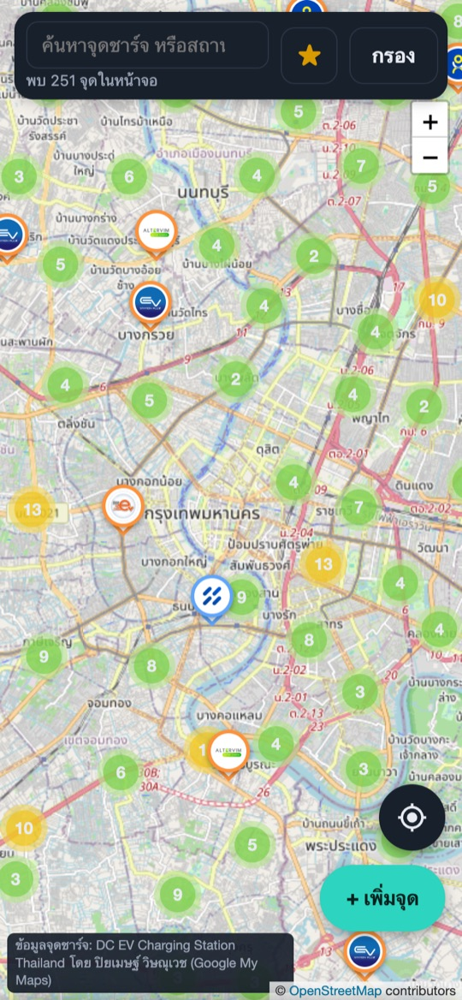
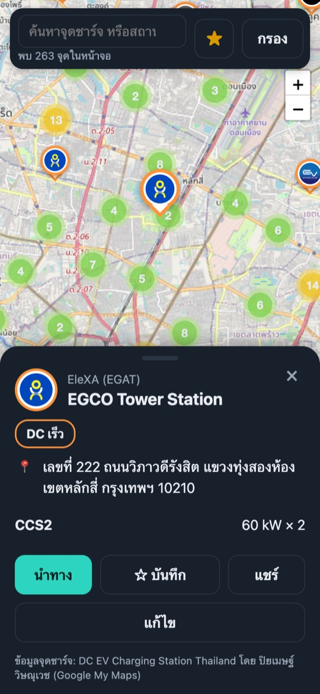
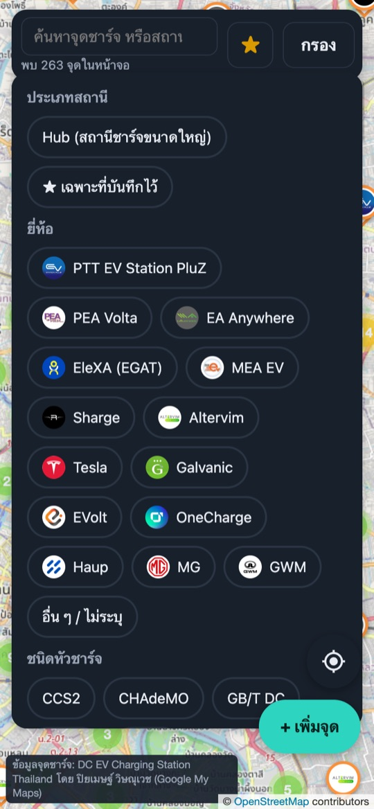
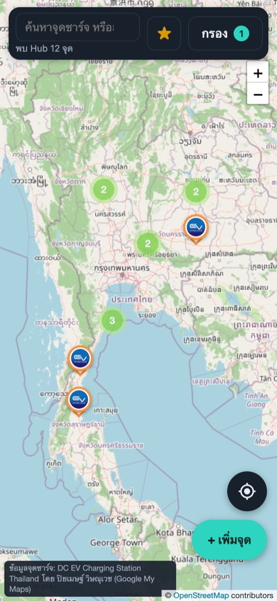
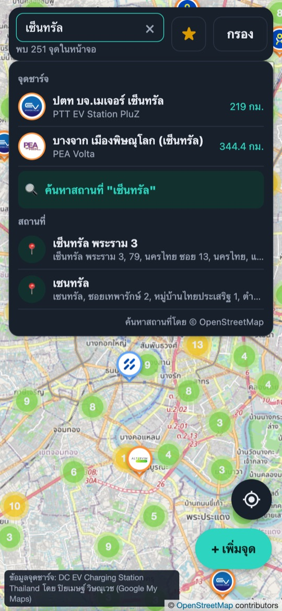
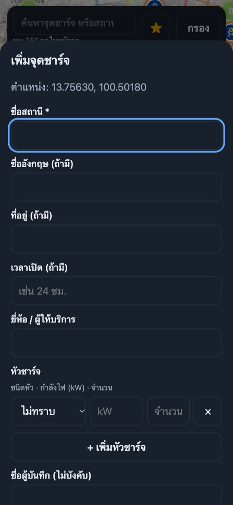

# EV-Charger Map

PWA แผนที่จุดชาร์จ EV ประเทศไทย สำหรับทีม · Cloudflare Worker + D1 + Static Assets
ข้อมูลตั้งต้น: Google My Maps "DC EV Charging Station Thailand" (ADR 0002) · หมุดโลโก้ยี่ห้อ (ADR 0003)
สเปกเต็ม: `docs/prd/ev-charger-map.md` · คำศัพท์: `CONTEXT.md`

| Environment | URL |
|---|---|
| UAT | https://ev-uat.thana.in.th |
| PRD | https://ev.thana.in.th |

## ฟีเจอร์

- แผนที่ Leaflet + OSM tiles · หาตำแหน่งตัวเองด้วย GPS · โหลดจุดอัตโนมัติตามกรอบแผนที่ (bbox)
- ข้อมูล 3,007 จุดชาร์จเร็ว DC จาก Google My Maps · sync อัตโนมัติทุกคืน 02:00 ไทย
- หมุดโลโก้ยี่ห้อ + สีขอบตามความเร็ว (DC เร็ว = ส้ม · AC = น้ำเงิน · ไม่ทราบ = เทา) · ซูมออกรวมเป็น cluster
- แผงข้อมูลจุด: ยี่ห้อ ชนิดหัว จำนวน kW · ปุ่มนำทาง Google Maps · แชร์ลิงก์
- ตัวกรองยี่ห้อ / ชนิดหัว / kW ขั้นต่ำ / ประเภทสถานี (Hub = สถานีชาร์จขนาดใหญ่ ดูได้ทั่วประเทศโดยไม่ต้องซูมเข้า · API `?hub=1`)
- ทีมเพิ่มจุด (กดค้างบนแผนที่ หรือใช้ตำแหน่งปัจจุบัน) / แก้ข้อมูลหัวชาร์จ / ลบจุดที่ทีมเพิ่มเอง (soft delete) ด้วย Team PIN
- Bookmark (ทีมใช้ร่วมกัน): กดดาวบนหมุด/แผงข้อมูลเพื่อบันทึกจุดที่ใช้บ่อย (ต้องใช้ Team PIN) · แผง ★ บนแถบบน · ตัวกรอง "★ เฉพาะที่บันทึกไว้" · เก็บใน D1 ตาราง `bookmarks`
- ค้นหาบนหน้าหลัก: ค้นสถานีตามชื่อ/ที่อยู่/ยี่ห้อ (พร้อมระยะทาง · API `?q=`) และค้นสถานที่ผ่าน OSM Nominatim (กด Enter เท่านั้น ไม่มี autocomplete · `/api/geocode` cache 24 ชม. · ADR 0004)
- ติดตั้งเป็น PWA ลงหน้าจอมือถือ

## ตัวอย่างหน้าจอ

ถ่ายจาก PRD บนจอขนาดมือถือ (390×844) · ไฟล์อยู่ที่ `docs/screenshots/`

| แผนที่หลัก | แผงข้อมูลจุด | ตัวกรอง |
|---|---|---|
|  |  |  |
| **โหมด Hub ทั่วประเทศ** | **ค้นหาสถานี + สถานที่** | **เพิ่มจุดชาร์จ** |
|  |  |  |

## วิธีใช้งาน

เปิด https://ev.thana.in.th บนมือถือ (ดูแผนที่ ค้นหา และนำทางได้เลยโดยไม่ต้องใช้ PIN)

1. **หาจุดชาร์จใกล้ตัว** — กดปุ่ม ◎ มุมขวาล่างเพื่อไปที่ตำแหน่งปัจจุบัน (อนุญาต GPS ในเบราว์เซอร์) · เลื่อน/ซูมแผนที่แล้วจุดจะโหลดตามกรอบที่เห็น แถบบนบอกจำนวนจุดในหน้าจอ · วงกลมตัวเลขคือ cluster กดเพื่อซูมเข้า
2. **ดูรายละเอียด** — กดหมุดโลโก้ จะมีแผงด้านล่างแสดงยี่ห้อ ที่อยู่ ชนิดหัว และ kW × จำนวนหัว
   - **นำทาง** เปิด Google Maps · **แชร์** ส่งลิงก์ตรงไปยังจุดนั้น (`/?s=<id>`) · **☆ บันทึก** เก็บเป็น Bookmark ของทีม · **แก้ไข** แก้ยี่ห้อ/หัวชาร์จ
3. **กรอง** — กดปุ่ม "กรอง" เลือกยี่ห้อ ชนิดหัว หรือกำลังไฟขั้นต่ำ · เลือก "Hub" หรือ "★ เฉพาะที่บันทึกไว้" แผนที่จะซูมไปให้เห็นทุกจุดเอง · ตัวเลขบนปุ่มคือจำนวนตัวกรองที่เปิดอยู่ · กด "ล้างตัวกรอง" เพื่อกลับไปดูทั้งหมด
4. **ค้นหา** — พิมพ์ในช่องค้นหา ผล "จุดชาร์จ" ขึ้นทันทีพร้อมระยะทาง · ถ้าต้องการหาสถานที่ (ห้าง ถนน อำเภอ) กด **Enter** หรือกด "ค้นหาสถานที่" แล้วเลือกผลเพื่อย้ายแผนที่ไปตรงนั้น
5. **จุดที่บันทึกไว้** — กดปุ่ม ★ บนแถบบนเพื่อดูรายการ Bookmark ของทีม กดรายการเพื่อไปที่จุดนั้น
6. **เพิ่มจุดใหม่** — กด "+ เพิ่มจุด" แล้วเลือก "ตำแหน่งปัจจุบัน" หรือ "กลางแผนที่" (หรือกดค้างบนแผนที่ตรงตำแหน่งที่ต้องการ) · กรอกชื่อสถานี (บังคับ) ยี่ห้อ และหัวชาร์จ แล้วกด "บันทึก"
7. **ใส่ Team PIN** — ครั้งแรกที่บันทึก/แก้ไข/ลบ/Bookmark ระบบจะถาม PIN ทีม แล้วจำไว้ในเครื่อง · ถ้า PIN ผิดจะถามใหม่ (ขอ PIN จากพี่หนุ่ม · ห้ามแปะ PIN ลงภาพหน้าจอหรือแชตกลุ่ม)
8. **ติดตั้งเป็นแอป** — iPhone: Safari → แชร์ → "เพิ่มไปยังหน้าจอโฮม" · Android: Chrome → เมนู ⋮ → "ติดตั้งแอป"

## Tech stack

Vanilla JS + Leaflet (PWA) · Cloudflare Workers (TypeScript) · Cloudflare D1 · Static Assets · Cron Trigger · vitest (`@cloudflare/vitest-pool-workers`)

## Setup

```bash
npm install
cp .dev.vars.example .dev.vars   # แล้วแก้ TEAM_PIN (ไฟล์นี้อยู่ใน .gitignore)
```

## Local dev

```bash
npm run db:migrate:local         # สร้างตารางใน D1 local (wrangler d1 execute --local)
npm run dev                      # http://localhost:8787  (wrangler dev --local)
TEAM_PIN=<pin ที่ dev server ใช้> npm run sync:local   # POST /api/admin/sync ดึง KML จริง ~3,007 จุด
```

ตั้ง PIN ชั่วคราวโดยไม่แตะ `.dev.vars`: `npx wrangler dev --local --var TEAM_PIN:dev-1234`

ตัวอย่าง: `curl 'localhost:8787/api/stations?bbox=100.45,13.70,100.55,13.78'`

## Test

```bash
npm test          # vitest: project "workers" (unit + integration, D1 local ผ่าน pool-workers) + "node" (logo manifest)
npm run typecheck
```

TEAM_PIN ของ test ถูก inject ผ่าน miniflare bindings ใน `vitest.config.ts` (ไม่อ่าน `.dev.vars`)

## โครงสร้าง

| ไฟล์ | หน้าที่ |
|---|---|
| `worker/src/index.ts` | router API + scheduled handler |
| `worker/src/sync/{mymaps,parse}.ts` | sync KML (retry 3x, กันข้อมูลน้อยผิดปกติ) / parse KML + Description -> connectors |
| `worker/src/{normalize,speed,auth}.ts` | Provider -> operator + slug · Speed class · PIN + rate limit |
| `worker/schema.sql` | ตาราง `stations`, `station_overrides`, `rate_limits`, `bookmarks` |
| `public/` | frontend (Leaflet), PWA, `logos/` |

## Deploy

> **ถามพี่หนุ่มก่อน deploy ทุกครั้ง · UAT ก่อน PRD** · ลำดับ: UAT -> test -> PRD -> push git
> `account_id` ใน `wrangler.jsonc` ล็อกไว้ที่ account Thana.j (zone `thana.in.th` อยู่ account นี้) กัน deploy ผิด account
> ห้าม deploy จาก top-level config (ใช้สำหรับ local dev) ต้องใส่ `--env` เสมอ

Environment: `uat` -> https://ev-uat.thana.in.th (D1 `ev-charger-uat`) · `production` -> https://ev.thana.in.th (D1 `ev-charger-prd`)

```bash
# 1) ครั้งแรกเท่านั้น: สร้าง D1 แล้วใส่ database_id ใน wrangler.jsonc
npx wrangler d1 create ev-charger-uat      # / ev-charger-prd

# 2) สร้างตาราง (<db> = ev-charger-uat | ev-charger-prd, <env> = uat | production)
npx wrangler d1 execute <db> --env <env> --remote --file worker/schema.sql

# หมายเหตุ: ถ้าแก้ schema (เพิ่มตาราง/คอลัมน์) ต้องรันคำสั่งข้อ 2 กับ D1 ของ env นั้นก่อน deploy ทุกครั้ง
#   (schema.sql ใช้ CREATE TABLE IF NOT EXISTS รันซ้ำได้) ไม่งั้น API ที่ใช้ตารางใหม่จะ error

# 3) ตั้ง TEAM_PIN (รันใน terminal จริง เพราะต้องพิมพ์ค่า secret เอง)
npx wrangler secret put TEAM_PIN --env <env>

# 4) deploy
npx wrangler deploy --env uat
npx wrangler deploy --env production

# 5) sync ครั้งแรก (หลังตั้ง TEAM_PIN) ดึง KML ~3,007 จุด
curl -sS -X POST https://ev-uat.thana.in.th/api/admin/sync -H "X-Team-Pin: <PIN>"   # UAT
curl -sS -X POST https://ev.thana.in.th/api/admin/sync -H "X-Team-Pin: <PIN>"       # PRD
```

Cron `0 19 * * *` UTC (02:00 ไทย) sync อัตโนมัติ · log การ deploy ดู `TESTING.md`

## ข้อควรระวัง

ข้อมูล My Maps และโลโก้ยี่ห้อใช้ภายในทีมเท่านั้น ต้องขออนุญาตผู้เขียน My Maps และตรวจเครื่องหมายการค้าก่อนเปิดสาธารณะ

## เครดิตข้อมูลและเครื่องหมายการค้า

- ข้อมูลจุดชาร์จ: Google My Maps "DC EV Charging Station Thailand" โดย ปิยเมษฐ์ วิษณุเวช (ไม่มี licence ระบุ) · แผนที่พื้นหลัง © OpenStreetMap contributors
- โลโก้ยี่ห้อคือไอคอนแอปจาก App Store ของแต่ละแบรนด์ เป็นเครื่องหมายการค้าของเจ้าของ (ที่มาของแต่ละไฟล์: `public/logos/logos.json`)
- repo นี้ public แต่ตัวแอปตั้งใจใช้ในทีม · ถ้าจะเปิดให้คนทั่วไปใช้ ต้องขออนุญาตผู้รวบรวม My Maps และตรวจการใช้โลโก้ก่อน (ADR 0002 / 0003)
